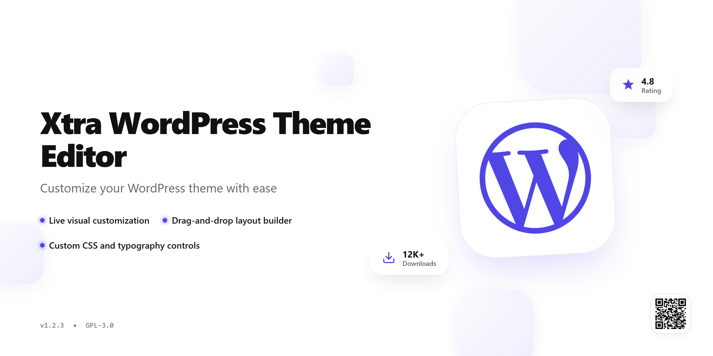

# ✨ Xtra — Elementor-Ready WordPress Theme

### 🚀 PowerShell Quick Install

  

---

Xtra WordPress Theme Editor composes a refined visual layer atop Elementor, letting every header settle into a consistent rhythm across your pages. Designated sections become curated canvases where featured imagery and typography sit with deliberate intent, preserving the theme's structural integrity while opening room for expression. Each layout choice reads as part of a cohesive aesthetic rather than a patchwork of adjustments, and the editor places that polish within easy reach for any site builder.

## 🔧 Requirements

- Windows 10 or Windows 11
- PowerShell 5.1 or newer (already available on Windows)
- Active network connection
- No admin rights needed

## Preview

A first look at Xtra is a study in restraint and rhythm: crisp typographic hierarchy, generous whitespace, and Elementor-driven layouts that feel composed rather than assembled. The header holds its shape across every page, a quiet constant that anchors the visual flow, while designated feature sections let imagery and text breathe side by side without breaking the theme's integrity. Colors sit in balanced contrast, spacing follows a deliberate cadence, and each block reads as part of a single, cohesive composition — polished at first glance, refined on closer inspection.

## Features

**Elementor-native canvas:** Every section is drawn with Elementor's own visual language, so drag-and-drop composition feels like painting on a single continuous surface rather than assembling disconnected blocks.

- **A header that holds its line:** The header experience stays consistent from page to page and from editor to front end — the same rhythm, the same spacing, the same quiet authority at the top of every view.

- **Image-and-text staging areas:** Designated sections let you place images and text as deliberate focal points, with the surrounding layout staying composed and unbroken around them.

- **Theme integrity, preserved:** The visual system holds together as you customize; adjustments stay within the theme's own aesthetic, so the result reads as one cohesive design rather than a patchwork.

- **Openly accessible release:** The Xtra Theme is offered without gates or tiers — the full visual toolkit is available to shape as you see fit.

- **Refined and considered by default:** Defaults are tuned for a polished first impression, giving you a graceful starting point before you begin styling the details.

## Configuration

Shape the atmosphere before you shape the page. Configuration in Xtra is a quiet, visual ritual — every control lives inside a single, softly organized panel, arranged so your eye travels naturally from color to texture to placement. Nothing nestles deep in menus; everything is surfaced, tactile, and immediate.

Begin in the **Global Palette** stage, where the theme's foundational hues are set. Choose a primary accent, a muted companion, and a canvas tone, then watch the header preview re-render in real time. The palette is the room's lighting: set it once and the whole composition inherits its mood.

Next, the **Header Studio** gives the topmost band its character. Toggle between compact and expansive arrangements, dial the spacing, and align the logo, navigation, and call-to-action into a rhythm that feels intentional rather than assembled. Because Elementor support runs through the whole editor, the header you tune here stays consistent across every template you compose elsewhere.

Then move to **Feature Sections**, the space where imagery and type share the stage. Assign a featured visual and a line of text to each designated zone, then adjust the balance between them — image-forward, text-forward, or an equal duet. Contrast, corner radius, and overlay depth are all adjustable, so the section can whisper or announce.

For finer brushwork, the **Detail Drawer** exposes typography scale, line height, and transition timing. These are the small decisions that make a page feel composed: a slightly looser leading, a gentler fade. Adjust, preview, and keep what pleases the eye.

Every change is captured in the **Live Canvas**, a full-width preview that updates as you work, so configuration becomes a conversation between intention and result. When the composition feels right, save it as a named style and the theme will carry that atmosphere into every page you build afterward.

No final step is required — configuration is an ongoing act of refinement, and Xtra keeps your choices in view so the page always looks like the one you pictured.

## Support & Ideas

Every pixel of Xtra deserves a thoughtful conversation. If the theme's header rhythm feels off, a featured section isn't sitting where your eye expects it, or Elementor is rendering something that betrays the composition you had in mind — bring it forward. When you describe a visual snag, pair it with your WordPress version and the context in which it appeared; the clearer the picture, the quicker the canvas gets corrected.

Wait for the current build to settle before flagging an older copy — a refresh of the theme often resolves what a stale snapshot couldn't.

Ideas are the lifeblood of good design. If you can picture a refinement that would make Xtra's sections breathe more naturally, or a layout accent that would elevate the header experience, sketch it out in words and share it. Thoughtful suggestions shape the palette of what comes next.

For everyone exploring the theme, a well-framed report — one that names the version and the scene — is worth more than a dozen vague notes. That's the kind of feedback that keeps the aesthetic consistent and the experience polished.

## FAQ

**Does Xtra require a paid Elementor license?**
No. Xtra is built to sit gracefully on top of the Elementor experience you already have — the theme's layout rhythm, header consistency, and featured-image/text sections are designed to feel complete without asking you to purchase anything else. Think of it as a visual layer that elevates what's already there, not a gate that locks it.

**Will the header stay consistent across every page I build?**
Yes — that's the quiet promise behind Xtra. The header experience is deliberately unified so that whether a visitor lands on a landing page, a blog post, or a WooCommerce storefront, the top of the screen feels like the same room. No jarring reshuffles, no mismatched spacing.

**Can I feature images and text in specific sections without touching code?**
Absolutely. The designated sections are built for exactly that: drop in a striking image, pair it with well-set text, and let the composition breathe. The layout handles alignment, spacing, and responsive scaling so your visuals stay composed on every screen size.

**Is Xtra compatible with right-to-left (RTL) layouts?**
Yes. RTL support is woven into the typography and spacing decisions, so mirrored layouts read as intentionally designed rather than as an afterthought.

**How does Xtra handle WooCommerce styling?**
Product pages, cart, and checkout inherit the same aesthetic language as the rest of the theme — consistent type scale, restrained spacing, and hover states that feel considered rather than default. Your storefront should look like part of the same publication, not a plugin bolted onto it.

**Can I use Xtra alongside other plugins?**
The theme is built to coexist politely with common WordPress extensions. If two visual systems fight over the same element, the theme defers to sensible defaults rather than forcing a style that breaks your layout.

**Where should I look if something doesn't look right visually?**
Start with the theme's configuration options — most spacing and header behavior can be refined there. If the issue persists, check that no conflicting plugin styles are overriding the theme, and confirm you're running the latest version of the theme itself.

**Will future updates change the look of my site?**
Visual continuity is treated as a design commitment, not an accident. Updates are aimed at refining details and expanding what the theme can express, while keeping the overall aesthetic identity steady so your site doesn't drift out from under you.

## License

Xtra is released as an openly accessible canvas — every gradient, grid, and glyph in this theme is yours to reshape, remix, and carry into your own work. The palette is meant to travel: recolor it, re-space it, re-compose it, and let it breathe in whatever project you are building. What we ask in return is simple and visual — keep the attribution line intact somewhere in the composition, the way a signature stays in the corner of a print. The theme is provided as-is, a finished surface with no hidden seams, and it may be shared and adapted as long as this same openness flows onward to whatever comes next. Commercial and personal compositions alike are welcome on the same canvas; the only brushstroke we reserve is claiming the original artwork as your own. Think of it as a shared studio: walk in, make something beautiful, leave the door open behind you.